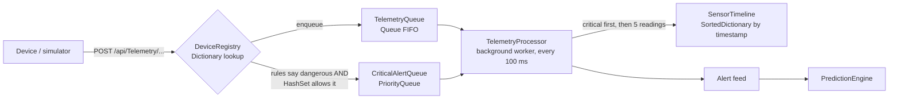

# Smart-X: IoT Mesh Ecosystem

**PROG7312 PoE, Part 2: Real-Time Processing and Device Management**

Smart-X is an operations console for IoT devices (ESP32 sensors, power meters,
pumps). Devices send telemetry to a **.NET 10 Web API**; a **React + TypeScript**
dashboard shows live readings, raises critical alerts, lets an operator send
override commands (with undo), and **suggests the next action** based on what
the operator did in the past.

| Layer | Technology |
|---|---|
| API | ASP.NET Core (.NET 10), controllers + minimal APIs, Swagger |
| Dashboard | React 19, TypeScript, Vite, Recharts |
| Authentication | Firebase Authentication (email and password) |
| Packaging | Docker and Docker Compose (nginx serves the dashboard) |

---

## Contents

1. [Quick start](#1-quick-start)
2. [Sign in (Firebase)](#2-sign-in-firebase)
3. [What the application does](#3-what-the-application-does)
4. [Project structure](#4-project-structure)
5. [Data structures used (Part 2)](#5-data-structures-used-part-2)
6. [How to test the data structures](#6-how-to-test-the-data-structures)
7. [Predictive Action Engine](#7-predictive-action-engine)
8. [Device import file format](#8-device-import-file-format)
9. [API reference](#9-api-reference)
10. [Alert thresholds and seeded demo data](#10-alert-thresholds-and-seeded-demo-data)
11. [Troubleshooting](#11-troubleshooting)
12. [Part 1 features (still included)](#12-part-1-features-still-included)

---

## 1. Quick start

There are three ways to run it. **Docker is the simplest and is what I recommend
for marking**, because it needs nothing installed except Docker.

### Option A: Docker Compose (recommended)

Requirements: [Docker Desktop](https://www.docker.com/products/docker-desktop/), running.

```bash
cd Smart-X
docker compose up --build
```

| What | Address |
|---|---|
| Dashboard | http://localhost:3000 |
| API health check | http://localhost:8080/api/health |
| Swagger UI (try every endpoint) | http://localhost:8080/swagger |

Stop it with `Ctrl+C`, then `docker compose down`.

> The Firebase settings are read from `Smart-X/.env` when the image is **built**.
> If you change them, run `docker compose up --build` again.

### Option B: Visual Studio (green button)

Requirements: Visual Studio with the ASP.NET workload, .NET 10 SDK and Node.js 20+.

1. Open `Smart-X/Smart-X.slnx`.
2. In the toolbar's run dropdown choose the **http** profile
   (**not** "Container (Dockerfile)", which starts the API only).
3. Press the green button.

The API starts on http://localhost:5217 **and automatically launches the React
dashboard** (SpaProxy runs `npm run dev`). Your browser opens on the dashboard at
http://localhost:5173. On the first Debug build the project runs `npm install` for you.

### Option C: Command line

Requirements: .NET 10 SDK, Node.js 20+.

Terminal 1: API

```bash
cd Smart-X/backend/Smart-X.Api
dotnet restore
dotnet run --no-launch-profile --urls http://localhost:5217 --environment Development
```

Terminal 2: dashboard

```bash
cd Smart-X/frontend/smartx-dashboard
npm install
npm run dev
```

Open http://localhost:5173. The dev server forwards every `/api/...` request to
the API on port 5217 (see `vite.config.ts`), exactly as nginx does in Docker.

---

## 2. Sign in (Firebase)

The dashboard is protected by **Firebase Authentication**. There are no hard-coded
usernames or passwords.

1. Open the dashboard and click **Sign up**.
2. Enter any email and a password of at least 6 characters.
3. You are signed in immediately; use **Log in** next time.

The Firebase web configuration lives in `Smart-X/.env` (`VITE_FIREBASE_*`).
A Firebase *web* config is a public identifier, not a secret, so it is committed
on purpose so the project runs straight after cloning. Access control is enforced
by Firebase's sign-in rules. `localhost` is an authorised domain by default.

---

## 3. What the application does

After signing in the sidebar shows the three modules:

| Module | Status |
|---|---|
| **Sensor Data Ingestion & Telemetry** | Part 1 (included and working) |
| **Real-Time Command Stream & History** | **Part 2 (this submission)** |
| **Network Topology & Mesh Routing** | Visible but greyed out (final PoE) |

Both active pages stay mounted when you switch tabs, so **no state, chart,
timer or simulator is lost** when moving between modules.

### The Command Stream page

| Section | What it shows |
|---|---|
| Counter cards | Telemetry queue, critical queue, disconnected nodes, active alerts and undo stack, each backed by a real data structure |
| **Suggested Actions** | Actions learned from the operator's own history, with confidence and the evidence behind them |
| **Automated Insights** | Faulty, offline or out-of-range devices, flagged before anyone searches |
| Devices | Grid with **search** (name, location, MAC) and **filters** by category and alert state |
| Live telemetry | Chart for the selected device, drawn from the sorted timeline |
| Manual Override | Pump on/off or relay toggle, with **Undo last command** |
| Critical Alert Feed | Processed alerts, each problem listed once |
| **Queue Stress Test** | Proves the FIFO queue and priority bypass (see section 6) |
| Device Simulator | Sends readings to the API like real ESP32 nodes |

The simulator uses the real telemetry endpoints, so simulated data reaches the
API exactly as hardware would send it.

### How one reading is processed



---

## 4. Project structure

```
Smart-X/
├── docker-compose.yml          Runs the API and the dashboard together
├── .env                        Firebase web config (public values)
├── sample-data/devices.txt     Example file for the device import
├── backend/Smart-X.Api/
│   ├── DataStructures/         TelemetryQueue, CriticalAlertQueue, CommandUndoStack,
│   │                           DeviceRegistry, SensorTimeline, DisconnectedNodes
│   ├── Services/               TelemetryService, TelemetryProcessor, AlertRules,
│   │                           AlertService, CommandService, PredictionEngine,
│   │                           DisconnectMonitor, DeviceImportService, ProcessingLog ...
│   ├── Controllers/            Telemetry, Alerts, Commands, Insights, DeviceImport ...
│   ├── Endpoints/              Minimal API: /api/sensors
│   ├── Models/                 Alert, DeviceCommand, UserAction, TelemetryPacket<T> ...
│   └── Dockerfile
└── frontend/smartx-dashboard/
    ├── src/App.tsx             Landing -> sign in -> dashboard
    ├── src/Dashboard.tsx       Sidebar + top bar (Purity UI layout)
    ├── src/pages/              LandingPage, AuthPage, IngestionPage, CommandStreamPage
    ├── src/services/           API calls, Firebase, device simulator
    ├── nginx.conf              Serves the app and forwards /api to the API
    └── Dockerfile
```

---

## 5. Data structures used (Part 2)

Every structure is in its own, purpose-named class under
`Smart-X/backend/Smart-X.Api/DataStructures/`.

| Requirement | Structure | Class and what it does |
|---|---|---|
| FIFO telemetry processing | `Queue<T>` | `TelemetryQueue`: incoming packets are processed in the order they arrived |
| Critical alerts bypass the queue | `PriorityQueue<Alert,int>` | `CriticalAlertQueue`: severity 1 (critical) is dequeued first, so a power spike jumps the line |
| Undo manual commands | `Stack<DeviceCommand>` | `CommandUndoStack`: LIFO; `Undo()` uses `TryPop`, so an empty stack returns "Nothing to undo" and **never crashes** |
| O(1) device lookup | `Dictionary<string,Sensor>` | `DeviceRegistry`: two dictionaries keyed on node ID and MAC address (case-insensitive) |
| Ordered historical logs | `SortedDictionary<DateTime,...>` | `SensorTimeline`: one per device, keyed on timestamp, so charts are always oldest to newest even if packets arrive out of order |
| No duplicate alerts | `HashSet<string>` | `DisconnectedNodes`: a set of disconnected nodes and a set of active alerts (`device:alertType`). `Add()` returns `false` for a duplicate, so the alert is not processed twice |
| Pattern learning | `Dictionary<string, Dictionary<string,int>>` | `PredictionEngine`: counts how often action B follows action A |

Also used: `List<T>`, a **jagged array** `double[][]` for raw telemetry history,
and generics (`TelemetryPacket<T>`).

---

## 6. How to test the data structures

Run the app first (section 1). The API address below is `http://localhost:8080`
for Docker, or `http://localhost:5217` for Visual Studio / command line.
The dashboard steps need you to be signed in.

> **API tests:** every command below is PowerShell (`Invoke-RestMethod`). You can
> also open Swagger at `/swagger` and use **Try it out**.
> Set the address once: `$api = "http://localhost:8080"`

### 6.1 Simulate a high-priority alert (the quickest demo)

1. Open **Real-Time Command Stream & History**.
2. Press **⚡ Simulate power spike** (or **💧 Simulate dry soil**) in the *Device Simulator* panel.
3. Within about 2 seconds a **critical alert** appears in the *Critical Alert Feed*
   (`PowerSpike on POWER-001`, or `LowMoisture on MOIST-001`), the device card turns
   **Alerting**, and the *Active alerts* counter goes to 1.

Same thing through the API:

```powershell
$spike = '{"deviceIdentifier":"POWER-001","data":{"voltage":230,"current":16,"power":3800,"energyConsumed":20}}'
Invoke-RestMethod "$api/api/Telemetry/power" -Method Post -ContentType "application/json" -Body $spike
Start-Sleep 1
Invoke-RestMethod "$api/api/alerts"          # the alert is listed
Invoke-RestMethod "$api/api/alerts/status"   # activeAlertKeys contains POWER-001:PowerSpike
```

### 6.2 Queue (FIFO) and Priority Queue: the stress test

1. In the Command Stream page scroll to **Queue Stress Test**.
2. Press **🚀 Run stress test**. It sends **150 normal readings at once and then one
   power spike last**.
3. Watch:
   * The **Telemetry queue** counter and the **queue depth chart** rise to roughly
     100+ and then drain over about 2-3 seconds. This is the FIFO backlog: readings
     are processed 5 at a time (about 50 per second) in arrival order.
   * In the **Processing log** find the line
     `PowerSpike on POWER-001 processed FIRST. N readings were already waiting; it waited a few ms.`
     The spike was sent **last** but was processed **before** the readings still
     waiting. That is the priority queue bypassing the normal queue.

### 6.3 HashSet: no duplicate alerts

1. Press **⚡ Simulate power spike**. This sends **three identical bad packets** in a row.
2. The *Critical Alert Feed* gets **one** `PowerSpike` entry, not three, and
   *Active alerts* shows 1.

API version (send the same spike three times):

```powershell
1..3 | % { Invoke-RestMethod "$api/api/Telemetry/power" -Method Post -ContentType "application/json" -Body $spike | Out-Null }
Start-Sleep 1
(Invoke-RestMethod "$api/api/alerts" | ? { $_.alertType -eq "PowerSpike" }).Count   # 1
```

Once a **healthy** reading arrives the active flag is cleared, so the same alert
can fire again for a later, separate incident. The **disconnected nodes** set works
the same way: a device silent for more than 60 seconds is flagged **once**.

### 6.4 Stack: undo

1. In *Manual Override* leave the target as **PUMP-001** and press **Pump On**.
   The history list shows `PumpOn on PUMP-001: Off → On`, and *Undo stack* shows 1.
2. Press **↶ Undo last command**: the message says the pump was reverted to `Off`.
3. Press **Undo** again: **"Nothing to undo."** The application does not crash.

```powershell
$cmd = '{"deviceIdentifier":"PUMP-001","commandName":"PumpOn","newState":"On"}'
Invoke-RestMethod "$api/api/commands" -Method Post -ContentType "application/json" -Body $cmd
Invoke-RestMethod "$api/api/commands/undo" -Method Post    # reverted to Off
Invoke-RestMethod "$api/api/commands/undo" -Method Post    # "Nothing to undo."
Invoke-RestMethod "$api/api/commands/history"
```

### 6.5 The whole loop: alert, command, effect, undo

1. Press **💧 Simulate dry soil**. Soil moisture on `MOIST-001` keeps falling,
   drops below 20%, and **one** `LowMoisture` alert is raised.
2. Press **Pump On** (target `PUMP-001`). The simulated soil now recovers, and
   once it is above 20% the active alert clears.
3. Press **Undo**. The pump goes back to Off, the soil dries out again and the
   alert is **raised again**.

### 6.6 Dictionary: instant lookup by MAC address or node ID

```powershell
Invoke-RestMethod "$api/api/sensors/by-mac/AA:BB:CC:DD:EE:03"   # POWER-001
Invoke-RestMethod "$api/api/sensors/by-node/pump-001"           # PUMP-001 (case-insensitive)
```

Both use `DeviceRegistry` (a `Dictionary`), not a loop over a list. The same
lookup runs for **every** incoming telemetry packet.

### 6.7 SortedDictionary: timeline always in time order

Send a **newer** reading, then an **older** one, then read the timeline:

```powershell
$now = [DateTime]::UtcNow
$new = '{"deviceIdentifier":"POWER-001","timestamp":"' + $now.AddMinutes(1).ToString("o")   + '","data":{"voltage":230,"current":5,"power":1000,"energyConsumed":1}}'
$old = '{"deviceIdentifier":"POWER-001","timestamp":"' + $now.AddMinutes(-30).ToString("o") + '","data":{"voltage":230,"current":5,"power":1001,"energyConsumed":1}}'
Invoke-RestMethod "$api/api/Telemetry/power" -Method Post -ContentType "application/json" -Body $new
Invoke-RestMethod "$api/api/Telemetry/power" -Method Post -ContentType "application/json" -Body $old
Start-Sleep 1
Invoke-RestMethod "$api/api/alerts/timeline/POWER-001"   # oldest -> newest (sorted)
Invoke-RestMethod "$api/api/Telemetry/POWER-001"         # arrival order (not sorted)
```

The two lists differ: the timeline (SortedDictionary) is in timestamp order, the
raw repository is in arrival order. The dashboard chart uses the sorted timeline.

### 6.8 Search and filter

In the **Devices** panel type `pump` or `greenhouse` in the search box, or use the
**category** and **alert state** dropdowns (Alerting / Disconnected / Healthy).
Devices are filtered instantly in the browser.

---

## 7. Predictive Action Engine

`Services/PredictionEngine.cs` learns from **recorded history**, not random rules.

1. Every **alert**, **search** and **command** is recorded with a timestamp
   (searches are reported to the API after you stop typing).
2. When an action B happens, the engine looks back **5 minutes** and adds 1 to a
   counter "A was followed by B" for each earlier action A.
3. When A happens again, the engine suggests the B that usually follows.
   **Confidence = (times B followed A) ÷ (times A happened).** A pattern needs at
   least 2 sightings.
4. Suggestions appear in **Suggested Actions** with the evidence, for example:
   *"Alert 'LowMoisture' on MOIST-001 happened 4 times and was followed by this action 3 times."*
5. **Automated Insights** is separate and uses live data: offline devices, devices
   that never reported, and out-of-range latest readings (the same rules the alert
   queue uses), shown before the user searches.

**Seeded demo history:** on first start the engine is given three past rounds of
`LowMoisture alert → search "Pump A" → PumpOn`, so there is something to learn
from. After that, every real action you take adds to the history.

**See it work:**

1. Press **💧 Simulate dry soil**.
2. *Suggested Actions* now shows **Search for 'Pump A'** and **Run 'PumpOn' on PUMP-001**
   with a confidence figure and the reason.
3. Click **Run**; this is a real command, and it is recorded too.
4. Open *Learned patterns* under the panel to see the raw counts.

---

## 8. Device import file format

On the **Sensor Data Ingestion** page, use **Import Devices from File** to upload
a `.txt` list. One device per line: `DeviceId, MAC, Location, Category`.

```
# lines starting with # and blank lines are ignored
SOIL-101, AA:BB:CC:00:01:01, Greenhouse 2 - Bed A, Environmental
METER-201, AA:BB:CC:00:02:01, Building B - Main Meter, PowerConsumption
PUMP-102, AA:BB:CC:00:03:01, Greenhouse 2 - Pump B, Actuator
```

Categories: `Environmental`, `PowerConsumption` (or `power`), `Actuator`.
Every line is validated like manual registration. Invalid lines (bad MAC, unknown
category, duplicate ID or MAC) are skipped and reported **with the reason**, and the
rest are imported. The sensor grid updates straight away.

An example is provided in `Smart-X/sample-data/devices.txt` (6 valid devices and
3 deliberately wrong lines).

---

## 9. API reference

| Method and route | Purpose |
|---|---|
| `GET /api/health` | Gateway status |
| `GET /api/sensors` / `POST /api/sensors` | List / register sensors |
| `GET /api/sensors/by-mac/{mac}` | Dictionary lookup by MAC address |
| `GET /api/sensors/by-node/{nodeId}` | Dictionary lookup by node ID |
| `POST /api/sensors/import` | Upload a `.txt` device list (multipart, field `file`) |
| `POST /api/Telemetry/environmental` `/power` `/actuator` | Ingest a `TelemetryPacket<T>` |
| `GET /api/Telemetry/{deviceId}` | All stored packets for a device (arrival order) |
| `GET /api/alerts` | Processed alerts, newest first |
| `GET /api/alerts/status` | Disconnected set, active alert set, queue depths |
| `GET /api/alerts/timeline/{deviceId}` | Sorted timeline (SortedDictionary) |
| `GET /api/alerts/processing-log` | Order in which alerts and batches were processed |
| `POST /api/commands` | Send an override `{deviceIdentifier, commandName, newState}` |
| `POST /api/commands/undo` | Undo the last command (safe on an empty stack) |
| `GET /api/commands/history` / `/states` | Command stack / current device states |
| `GET /api/insights` | Suggested actions, insights and learned patterns |
| `POST /api/insights/search` | Record a search for the engine `{query}` |

Part 1 endpoints (media upload, issues, history, deployment validation,
aggregation) are unchanged. See Swagger for the full list.

---

## 10. Alert thresholds and seeded demo data

| Rule | Condition | Severity |
|---|---|---|
| `LowMoisture` | Environmental humidity below 20% | 1 (critical) |
| `HighTemperature` | Temperature above 50 °C | 1 (critical) |
| `PowerSpike` | Power above 3000 W | 1 (critical) |
| `VoltageFault` | Voltage outside 200–250 V | 2 (warning) |
| `Disconnected` | No telemetry for 60 seconds | 2 (warning) |

Seeded devices on start-up:

| Device | MAC | Category | Location |
|---|---|---|---|
| TEMP-001 | AA:BB:CC:DD:EE:01 | Environmental | Building A - Room 101 |
| TEMP-002 | AA:BB:CC:DD:EE:02 | Environmental | Building A - Room 102 (silent on purpose) |
| POWER-001 | AA:BB:CC:DD:EE:03 | PowerConsumption | Building A - Main Distribution |
| ACT-001 | AA:BB:CC:DD:EE:04 | Actuator | Building A - HVAC |
| MOIST-001 | AA:BB:CC:DD:EE:05 | Environmental | Greenhouse 1 - Bed B |
| PUMP-001 | AA:BB:CC:DD:EE:06 | Actuator | Greenhouse 1 - Pump A |

`TEMP-002` never reports, so the dashboard always has an offline device to flag.
Data is held **in memory**, so restarting the API resets it.

---

## 11. Troubleshooting

| Problem | Fix |
|---|---|
| Visual Studio shows the API only / Swagger, no dashboard | Choose the **http** profile, not "Container (Dockerfile)" |
| "Debugging compound launch.json is currently unsupported" | That is a VS Code file; in Visual Studio use the **http** profile |
| Dashboard says "Authentication is not configured" | The `VITE_FIREBASE_*` values in `Smart-X/.env` are missing; fill them in and rebuild (`docker compose up --build`) |
| Docker error about `dockerDesktopLinuxEngine` | Docker Desktop is not running; start it |
| Page loads but "Gateway: Offline" / 502 in dev | The API is not running or still starting on port 5217 |
| Ports already in use | Stop other apps on 3000, 8080, 5173 or 5217 |
| Changes not visible in Docker | Re-run `docker compose up --build` |

---

## 12. Part 1 features (still included)

* Sensor registration with MAC, location and category, validated on the client and the API.
* `TelemetryPacket<T>`: a generic wrapper, no boxing or unboxing.
* Operator overloading: `SensorReading` supports `+` to aggregate two meters.
* A jagged array (`double[][]`) for raw telemetry history, then `List<T>` collections.
* A recursive validator for nested deployment trees.
* Multipart upload of logs and photos to a sensor profile.
* Issue reporting, the "Attention Required" engagement banner and a live telemetry chart.

---

*Demo video:* **(add the YouTube link here before submitting)**
