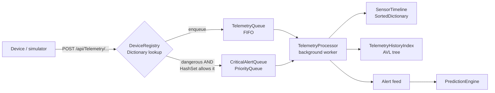

# Smart-X: IoT Mesh Ecosystem

Smart-X is an operations console for IoT devices (ESP32 sensors, power meters,
pumps). Devices send telemetry to a **.NET 10 Web API**. A **React + TypeScript**
dashboard then lets an operator:

* register sensors and watch live readings,
* handle critical alerts, send override commands (with undo) and get suggested actions,
* explore the **mesh network**: trace routes by node ID or MAC address, see which
  nodes are down and where traffic can hop instead, find the most power-efficient
  routes, and query a sensor's history by time range.

| Layer | Technology |
|---|---|
| API | ASP.NET Core (.NET 10), controllers + minimal APIs, Swagger |
| Dashboard | React 19, TypeScript, Vite, Recharts |
| Authentication | Firebase Authentication (email and password) |
| Packaging | Docker and Docker Compose (nginx serves the dashboard) |

## Contents

1. [Quick start](#1-quick-start)
2. [Sign in](#2-sign-in)
3. [Using the application](#3-using-the-application)
4. [Project structure](#4-project-structure)
5. [Data structures](#5-data-structures)
6. [Network Topology: how it works](#6-network-topology-how-it-works)
7. [API reference](#7-api-reference)
8. [Seed data and alert rules](#8-seed-data-and-alert-rules)
9. [Testing](#9-testing)
10. [Device import format](#10-device-import-file-format)
11. [Troubleshooting](#11-troubleshooting)

---

## 1. Quick start

### Option A: Docker Compose (recommended)

Requires [Docker Desktop](https://www.docker.com/products/docker-desktop/), running.

```bash
cd Smart-X
docker compose up --build
```

| What | Address |
|---|---|
| Dashboard | http://localhost:3000 |
| API health check | http://localhost:8080/api/health |
| Swagger UI | http://localhost:8080/swagger |

Stop with `Ctrl+C`, then `docker compose down`. The Firebase settings are read from
`Smart-X/.env` when the image is **built**, so re-run with `--build` if you change them.

### Option B: Visual Studio

Requires Visual Studio with the ASP.NET workload, the .NET 10 SDK and Node.js 20+.

1. Open `Smart-X/Smart-X.slnx`.
2. Choose the **http** launch profile (not "Container (Dockerfile)", which starts the API only).
3. Press the green button.

The API starts on http://localhost:5217 and launches the dashboard at
http://localhost:5173. The first Debug build runs `npm install` for you.

### Option C: Command line

Requires the .NET 10 SDK and Node.js 20+.

```bash
# Terminal 1: API
cd Smart-X/backend/Smart-X.Api
dotnet restore
dotnet run --no-launch-profile --urls http://localhost:5217 --environment Development

# Terminal 2: dashboard
cd Smart-X/frontend/smartx-dashboard
npm install
npm run dev
```

Open http://localhost:5173. The dev server forwards `/api/...` to port 5217
(see `vite.config.ts`), as nginx does in Docker.

---

## 2. Sign in

The dashboard uses **Firebase Authentication**. Click **Sign up**, enter any email
and a password of at least 6 characters, and you are signed in. Use **Log in**
next time.

The Firebase web configuration is in `Smart-X/.env` (`VITE_FIREBASE_*`). A Firebase
*web* config is a public identifier, not a secret, so it is committed so the project
runs straight after cloning.

---

## 3. Using the application

The sidebar has three pages. All three stay mounted when you switch between them,
so charts, timers and the simulator keep running.

| Page | What you can do |
|---|---|
| **Telemetry Ingestion** | Register sensors (MAC, location, category), import a device list, attach logs and photos, report issues, watch live readings |
| **Command Stream** | Live alerts, manual overrides with undo, device search and filters, a simulator and a queue stress test, plus suggested actions learned from operator history |
| **Mesh Topology** | The mesh map, route tracker, connectivity check (BFS/DFS), failure simulation and historical telemetry log (section 6) |

How one reading is processed:



**Try it:** on the Command Stream page press **Simulate power spike** and a critical
alert appears within about 2 seconds. Press **Pump On** then **Undo** to see the
command stack. On the Mesh Topology page search `AA:BB:CC:DD:EE:0D`, then fail a
node and watch the routes change.

---

## 4. Project structure

```
Smart-X/
├── docker-compose.yml
├── .env                          Firebase web config (public values)
├── sample-data/devices.txt       Example device import file
├── backend/
│   ├── Smart-X.Api/
│   │   ├── DataStructures/       Queues, stack, dictionaries, sets, AvlTree, MinHeap, MeshGraph ...
│   │   ├── Services/             Telemetry pipeline, alerts, commands, prediction, mesh topology ...
│   │   ├── Controllers/          Telemetry, Alerts, Commands, Insights, Mesh ...
│   │   ├── Endpoints/            Minimal API: /api/sensors
│   │   ├── Models/               Alert, DeviceCommand, TelemetryPacket<T> ...
│   │   └── Dockerfile
│   └── Smart-X.Api.Tests/        xUnit tests
└── frontend/smartx-dashboard/
    ├── src/Dashboard.tsx         Sidebar and top bar
    ├── src/pages/                Landing, Auth, Ingestion, CommandStream, MeshTopology
    ├── src/services/             API calls, Firebase, device simulator
    └── nginx.conf, Dockerfile
```

---

## 5. Data structures

Each structure is its own class under `backend/Smart-X.Api/DataStructures/`.

| Structure | Class | Purpose |
|---|---|---|
| `Queue<T>` | `TelemetryQueue` | Process incoming packets in arrival order (FIFO) |
| `PriorityQueue<Alert,int>` | `CriticalAlertQueue` | Critical alerts jump ahead of normal telemetry |
| `Stack<T>` | `CommandUndoStack` | Undo manual commands; an empty stack returns "Nothing to undo" |
| `Dictionary` | `DeviceRegistry` | O(1) device lookup by node ID or MAC address |
| `SortedDictionary` | `SensorTimeline` | Live chart data, always oldest to newest |
| `HashSet` | `DisconnectedNodes` | No duplicate alerts; `Add()` returns `false` for a repeat |
| Prediction counters | `PredictionEngine` | Counts how often action B follows action A |
| **AVL tree** | `AvlTree`, `TelemetryHistoryIndex` | Time-range queries on sensor history |
| **Graph** (BFS, DFS) | `MeshGraph` | The mesh network, connectivity and failover |
| **Min-heap** + **Prim's MST** | `MinHeap`, `MeshGraph.PrimMst` | Most power-efficient routing tree |

Also used: `List<T>`, a jagged array (`double[][]`) for raw history, and generics
(`TelemetryPacket<T>`, `AvlTree<TKey,TValue>`).

---

## 6. Network Topology: how it works

### The mesh

In a mesh network every node can reach several neighbours, so a packet hops from
sensor to sensor until it reaches the gateway, and the network re-routes around a
failed node (as Zigbee, Thread and ESP-NOW do). Smart-X models **13 sensors plus
the gateway `GATEWAY-01`, joined by 25 wireless links**. Each link has a power cost
in mW. Each node is seeded with 24 hours of history (one reading every 2 minutes).

A node is **down** when it is in the mesh's failure set. `TEMP-002` starts down (it
never reports), and you can fail or restore any other node from the page. Mesh
health is kept separate from the 60-second disconnect alert so the demo mesh does
not turn red whenever the simulator is off.

### The page

| Section | What it does |
|---|---|
| Summary cards | Connected / down / isolated counts, total MST power cost and the saving over keeping every link on |
| Mesh map | Click a node. Teal = MST links, grey = spare links, dashed red = links to a dead node, orange = tracked route |
| Route tracker | Enter a node ID **or MAC address** to see its hops to the gateway and the power cost |
| Connectivity | BFS or DFS from the gateway: connected nodes, down nodes with "hop via" options, and routes that had to change |
| Historical log | Choose a node and time window for an AVL range query, with a chart, table and query statistics |

### 6.1 AVL tree: historical queries

`AvlTree.cs`, used by `TelemetryHistoryIndex.cs`. Each node has its own
`AvlTree<DateTime, ITelemetryPacket>` keyed on the reading's timestamp. An AVL tree is
a binary search tree that rotates itself whenever the heights of a node's two
subtrees differ by more than 1.

*Why not a plain BST or list?* Telemetry arrives in time order, which turns an
ordinary BST into a chain and every query into an O(n) scan. The rotations keep the
height near log2(n): 721 readings sit in a tree of height 10.

```csharp
private Node Rebalance(Node node)
{
    UpdateHeight(node);
    int balance = BalanceFactor(node);          // left height - right height
    if (balance > 1)                            // left heavy
    {
        if (BalanceFactor(node.Left!) < 0) node.Left = RotateLeft(node.Left!);
        return RotateRight(node);
    }
    if (balance < -1)                           // right heavy
    {
        if (BalanceFactor(node.Right!) > 0) node.Right = RotateRight(node.Right!);
        return RotateLeft(node);
    }
    return node;
}
```

A range query ("moisture readings between 14:00 and 16:00 for Node A") skips whole
branches that cannot match, so it costs **O(log n + k)** for k results instead of O(n):

```csharp
if (from.CompareTo(node.Key) < 0)  CollectRange(node.Left, ...);   // matches possible on the left?
if (from.CompareTo(node.Key) <= 0 && to.CompareTo(node.Key) >= 0)
    output.Add(new(node.Key, node.Value));                          // this node is in range
if (to.CompareTo(node.Key) > 0)    CollectRange(node.Right, ...);  // matches possible on the right?
```

The page shows the saving: a 2-hour window on a node with 732 readings returned 60
readings after visiting 69 tree nodes instead of checking 732.

### 6.2 Graph with BFS and DFS: topology and failover

`MeshGraph.cs`, used by `MeshTopologyService.cs`. The mesh is an undirected weighted
graph stored as an **adjacency list** (`Dictionary<string, List<MeshEdge>>`): vertices
are the nodes and gateway, edges are links weighted by power cost. A mesh is sparse,
so a list uses O(V + E) memory where a matrix would use O(V²).

**Breadth-first search** starts at the gateway and visits every node still connected,
giving each its fewest-hop distance. Down nodes are skipped, so anything BFS cannot
reach is down or cut off. **Depth-first search** finds the same set in a different
order. Both are O(V + E) and selectable on the page.

```csharp
var queue = new Queue<TraversalStep>();
queue.Enqueue(new TraversalStep(start, null, 0));
while (queue.Count > 0)
{
    var current = queue.Dequeue();
    order.Add(current);
    foreach (var link in LinksOf(current.Node))
    {
        string next = link.Other(current.Node);
        if (isUp(next) && seen.Add(next))              // skip dead and already-seen nodes
            queue.Enqueue(new TraversalStep(next, current.Node, current.Hops + 1));
    }
}
```

For each down node, the service lists its working neighbours that can still reach the
gateway (cheapest link first), which answers "where do we hop instead?". It also compares
the healthy network's routes with the damaged network's and shows each affected node's
old and new path, or **Isolated** if none is left.

### 6.3 Min-heap and Prim's MST: power-efficient routing

`MinHeap.cs` and `MeshGraph.PrimMst`. A **minimum spanning tree** connects every
reachable node with the cheapest set of links and no loops (V − 1 links). Telemetry
travels up the tree to the gateway, and the unused links can sleep. In the seeded
network the MST uses 12 links for **127 mW**, against 272 mW with all 22 working
links on (53% less).

Prim's algorithm grows the tree from the gateway, always attaching the cheapest link
to a new node. The **binary min-heap** (a complete tree stored in a list) returns that
link in O(log n), giving **O(E log V)** overall:

```csharp
heap.Push((link, node), link.PowerCost);        // sift up,   O(log n)
...
var (item, cost) = heap.Pop();                  // cheapest link, sift down, O(log n)
string newNode = item.Edge.Other(item.Via);
if (!inTree.Add(newNode)) continue;             // already reached by a cheaper link
edges.Add(item.Edge);
parent[newNode] = item.Via;                     // route: child -> parent -> ... -> gateway
```

After a failure, Prim simply runs again without the dead node, so new routes come
from the same algorithm. Note that an MST minimises the **total** network power, not
every node's individual path.

---

## 7. API reference

| Method and route | Purpose |
|---|---|
| `GET /api/health` | Gateway status |
| `GET` / `POST /api/sensors` | List / register sensors |
| `GET /api/sensors/by-mac/{mac}`, `/by-node/{nodeId}` | Dictionary lookups |
| `POST /api/sensors/import` | Upload a `.txt` device list (multipart, field `file`) |
| `POST /api/Telemetry/environmental`, `/power`, `/actuator` | Ingest a `TelemetryPacket<T>` |
| `GET /api/Telemetry/{deviceId}` | Stored packets for a device |
| `GET /api/alerts`, `/alerts/status`, `/alerts/processing-log` | Alerts, set and queue state, processing order |
| `GET /api/alerts/timeline/{deviceId}` | Sorted timeline |
| `POST /api/commands`, `/commands/undo` | Send an override / undo the last one |
| `GET /api/commands/history`, `/commands/states` | Command stack / device states |
| `GET /api/insights`, `POST /api/insights/search` | Suggested actions / record a search |
| `GET /api/mesh/topology` | Nodes, links and summary numbers |
| `POST /api/mesh/nodes/{id}/status` | Body `{"down": true}`: fail or restore a node |
| `GET /api/mesh/traverse?mode=bfs\|dfs` | Visit order, down nodes, hop options, changed routes |
| `GET /api/mesh/mst` | Prim's tree and total cost |
| `GET /api/mesh/route/{idOrMac}` | Route to the gateway |
| `GET /api/mesh/history/{idOrMac}?from=&to=&limit=` | AVL range query (UTC timestamps) with statistics |

Swagger lists every endpoint, including media upload, issues and deployment validation.

```powershell
$api = "http://localhost:8080"          # http://localhost:5217 outside Docker
Invoke-RestMethod "$api/api/mesh/route/AA:BB:CC:DD:EE:0D"
Invoke-RestMethod "$api/api/mesh/nodes/ACT-001/status" -Method Post `
    -ContentType "application/json" -Body '{"down":true}'
```

---

## 8. Seed data and alert rules

| Rule | Condition | Severity |
|---|---|---|
| `LowMoisture` | Humidity below 20% | 1 (critical) |
| `HighTemperature` | Temperature above 50 °C | 1 (critical) |
| `PowerSpike` | Power above 3000 W | 1 (critical) |
| `VoltageFault` | Voltage outside 200–250 V | 2 (warning) |
| `Disconnected` | No telemetry for 60 seconds | 2 (warning) |

Seeded sensors: `TEMP-001`, `TEMP-002` (silent on purpose), `POWER-001`, `ACT-001`,
`MOIST-001`, `PUMP-001` (MACs `AA:BB:CC:DD:EE:01` to `06`), plus `TEMP-003`, `TEMP-004`,
`MOIST-002`, `MOIST-003`, `POWER-002`, `ACT-002`, `PUMP-002` (MACs `...:07` to `0D`).
The Command Stream page also starts with some past operator history for the
prediction engine to learn from.

All data is held **in memory**, so restarting the API resets it. Sensors registered
later are not wired into the mesh, whose links are defined in the seed data.

---

## 9. Testing

17 xUnit tests cover the AVL tree (balance, range bounds, nodes visited), the
min-heap, BFS/DFS and Prim's MST (including re-routing around a failed node):

```bash
cd Smart-X/backend
dotnet test Smart-X.Api.Tests
```

The other structures can be tried from the dashboard: the **Queue Stress Test** sends
150 readings and then a power spike, and the processing log shows the spike handled
first. **Simulate power spike** sends three identical packets and only one alert
appears (the HashSet). **Pump On** then **Undo** exercises the stack.

---

## 10. Device import file format

On the Telemetry Ingestion page, use **Import Devices from File**. One device per
line: `DeviceId, MAC, Location, Category`.

```
# lines starting with # and blank lines are ignored
SOIL-101, AA:BB:CC:00:01:01, Greenhouse 2 - Bed A, Environmental
METER-201, AA:BB:CC:00:02:01, Building B - Main Meter, PowerConsumption
PUMP-102, AA:BB:CC:00:03:01, Greenhouse 2 - Pump B, Actuator
```

Categories: `Environmental`, `PowerConsumption` (or `power`), `Actuator`. Invalid lines
are skipped and reported with the reason. See `Smart-X/sample-data/devices.txt`.

---

## 11. Troubleshooting

| Problem | Fix |
|---|---|
| Visual Studio shows only the API / Swagger | Choose the **http** profile, not "Container (Dockerfile)" |
| "Authentication is not configured" | Fill in the `VITE_FIREBASE_*` values in `Smart-X/.env` and rebuild |
| Docker error about `dockerDesktopLinuxEngine` | Docker Desktop is not running; start it |
| "Gateway: Offline" or 502 in dev | The API is not running yet on port 5217 |
| Ports already in use | Stop other apps on 3000, 8080, 5173 or 5217 |
| Changes not visible in Docker | Re-run `docker compose up --build` |
